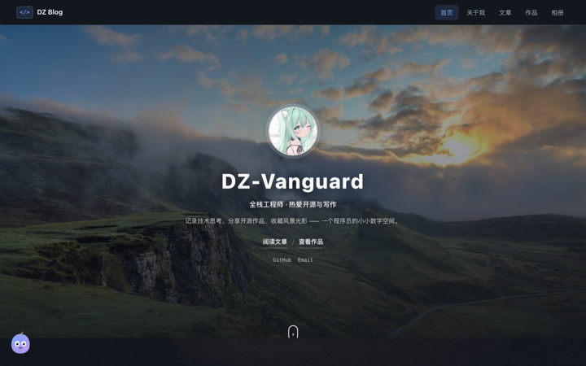
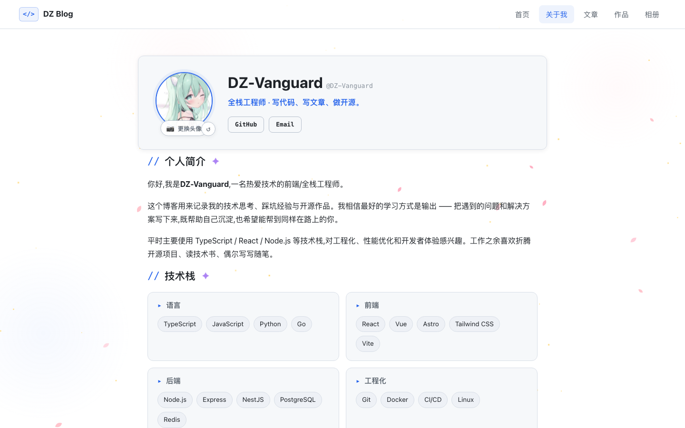
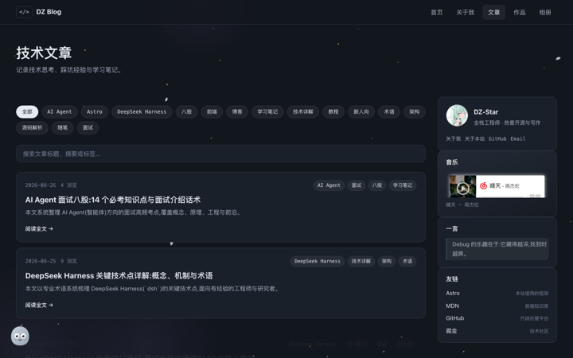
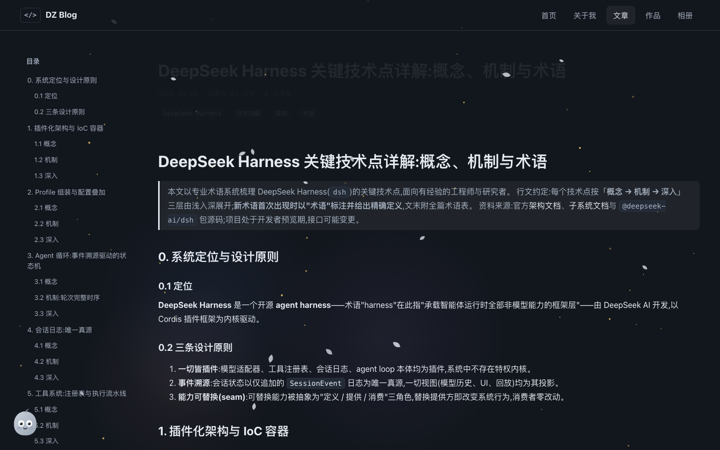
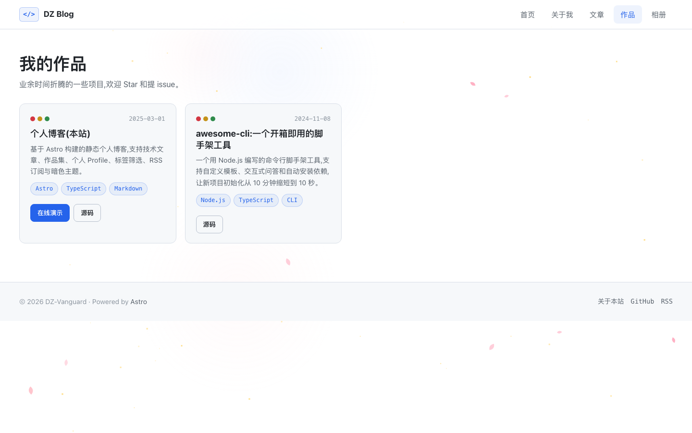
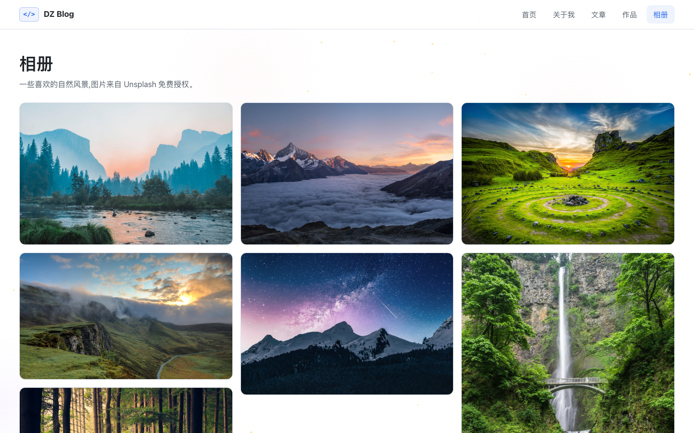

# 个人博客(全栈版)

> 📘 **快速了解项目全貌**(技术架构 / 路由 / 数据模型 / 已知问题 / 改动约定):看 [**AGENTS.md**](./AGENTS.md)。
> 部署上线看 [**DEPLOY.md**](./DEPLOY.md)。

基于 **Astro(SSR)+ SQLite** 的完整个人博客:前台是深色主题 + 动画的展示站,后台是网页管理界面,文章/作品/站点信息全部存在自己的数据库里。

## 📸 界面预览

| 首页 | 关于我 |
| :---: | :---: |
|  |  |

| 文章列表 | 文章详情(左侧目录) |
| :---: | :---: |
|  |  |

| 作品集 | 相册 |
| :---: | :---: |
|  |  |

| 后台登录 | |
| :---: | :---: |
|  | |

> 以上为最新版本截图(1440×900),本地构建运行后截取;部署后可更新为线上域名截图。

## ✨ 功能

**前台**
- 👤 关于我:头像(支持上传)、个人简介、技术栈、经历
- 📝 技术文章:Markdown 渲染、代码高亮、目录、实时搜索、标签页、上一篇/下一篇
- 🚀 作品集:作品卡片、在线演示/源码链接、首页精选
- 🎬 动态背景:樱花飘落、星光闪烁、漂浮光斑、鼠标火花拖尾(每个页面跳转后都保持动画)
- 🖱 自定义光标 + 深色主题 + 页面过渡、hero 打字机、滚动渐显、阅读进度条、回到顶部
- 📐 加宽布局 + 头像紧贴左侧 Hero + 侧栏小组件(音乐歌单/一言轮播/网站统计/标签云/最新文章/友链)
- 🍳 下厨栏目:做饭研究笔记。左侧列表 + 右侧常驻详情面板(点开不跳页),移动端自动变底部抽屉;
  分「做过的」(含尝试次数、翻车记录、步骤)与「想学的」(参考图 + 为什么想学)
- 🖼 内页背景:每个页面一张主题背景图 + 蒙层 + 色调光晕,不再是纯色底
- 👻 页面小人物 + 小组件条:会眨眼的小幽灵(点它说话)、实时时钟、热门文章、随机来一篇
- 🎵 网络歌单音乐播放器:服务端抓取歌单(默认网易云热歌榜)、可搜索选歌、真实播放、进度拖动/音量、切页面不中断,第三方音源失效自动走本站代理
- 🖼 相册页(瀑布流 + 灯箱预览)+ 🍜 关于本站页(技术栈/改版历史/致谢)
- 📡 RSS + Sitemap(动态生成)

**后台(`/admin`)**
- 🔐 管理员登录(会话 Cookie + 登录限流)
- ✍️ 在线写文章/作品:Markdown 编辑器 + 实时预览 + 草稿箱
- ⚙️ 站点设置:标题、简介、域名、Hero 文案、社交链接、个人简介
- 📷 头像上传:自动裁切压缩,全站生效
- 🔑 修改密码

**存储**
- 🗄 SQLite 数据库(`data/blog.db`,零外部依赖)
- 首次启动自动把 `src/content/` 下的旧 Markdown 迁移入库

## 🚀 本地运行

```bash
npm install
npm run dev        # http://localhost:4321
npm run build      # SSR 构建
npm start          # 运行生产服务(需先 build)
```

**首次登录后台**:打开 `/admin`,默认账号 `admin / admin123`,登录后**立即改密码**。

## 📁 项目结构

```
├── DEPLOY.md                # ⭐ 部署手册(从零到上线,含故障排查与已知限制)
├── deploy/                  # 部署脚本目录(⚠️ 当前为空,脚本在 926c8cc 被误删)
│                            #    恢复: git checkout 926c8cc^ -- deploy/
├── .github/workflows/       # GitHub Actions 自动部署(push main 触发)
├── src/
│   ├── lib/                 # 核心逻辑
│   │   ├── db.ts            # SQLite 数据层(node:sqlite,零依赖)
│   │   ├── auth.ts          # 密码哈希 + 会话
│   │   ├── md.ts            # Markdown 渲染 + shiki 高亮
│   │   ├── music.ts         # 网络歌单抓取 + 缓存 + 音频代理
│   │   └── http.ts          # API 工具
│   ├── pages/
│   │   ├── index.astro      # 首页
│   │   ├── about.astro      # 关于我
│   │   ├── kitchen/         # 下厨(列表 + 菜品详情)
│   │   ├── blog/            # 文章列表/详情/标签
│   │   ├── works/           # 作品列表/详情
│   │   ├── admin/           # 后台(登录/仪表盘/编辑器/设置)
│   │   └── api/             # 后端 API(含 /api/music 歌单、/api/music/stream 音频代理)
│   ├── components/          # 前台组件 + admin 编辑器
│   ├── layouts/             # BaseLayout / AdminLayout
│   ├── scripts/             # 前台交互(site:打字机/渐显/搜索;music:播放器)
│   ├── styles/global.css    # 深色主题 + 动画(CSS 变量换主题)
│   └── content/             # 旧 Markdown(首次启动自动迁移,可保留作备份)
├── data/                    # SQLite 数据库(自动生成,已 gitignore)
└── astro.config.mjs         # SSR + node adapter
```

## ☁️ 部署到服务器

**完整步骤见 [`DEPLOY.md`](./DEPLOY.md)**,包含从装 Node 到配 HTTPS 的每条命令、验收清单与故障排查表。

**流程概览**:

1. 租服务器:2 核 2G / Ubuntu 24.04 / 磁盘 40G+(2G 内存建议开 swap)
2. 安全组放行 22 / 80 / 443,出站放行(首页音乐歌单要访问第三方接口)
3. 装 **Node ≥ 22.5**(代码用内置 `node:sqlite`)+ PM2
4. `git clone` 到 `/var/www/blog`,配置 `ecosystem.config.cjs`(含 `DB_PATH`、首次用的 `ADMIN_PASSWORD`)
5. `npm ci && npm run build` → `pm2 start` → `pm2 save && pm2 startup`
6. Caddy 反代:`:80`(纯 IP)或域名自动 HTTPS
7. 后台 `/admin` 登录 → 立即改密码 → 把「设置」里的站点 URL 改成实际地址
8. GitHub Actions 配 `SSH_HOST` / `SSH_USER` / `SSH_KEY` 三个 Secret,之后 `git push` 自动上线

**三条实测限制**(详见 DEPLOY.md「已知限制」):

- 后台上传的头像写在 `dist/client/uploads`,**每次部署会被清空**;临时改用仓库内 `public/touxiang.jpg`
- `deploy/` 下的脚本在 `926c8cc` 被误删,手册用等价手工命令替代
- 生产构建的会话 Cookie 带 `Secure`,**纯 HTTP 访问时后台登不进去**(访客浏览不受影响),需 HTTPS 或 SSH 隧道

**数据安全**:SQLite 位于 `/var/www/blog/data/blog.db`,不在 git 中;建议每日 cron 备份并定期下载到本地。

## 🎨 个性化

| 想改什么 | 改哪里 |
| --- | --- |
| 站点信息(标题/域名/社交) | 后台「设置」在线修改 |
| 个人简介 | 后台「设置」在线修改 |
| 头像 | 后台「设置」上传;默认头像在 `public/touxiang.jpg`(替换该文件即可) |
| 技能/经历/教育(结构化) | `src/data/profile.ts` |
| 音乐歌单(平台/歌单/接口) | `src/data/widgets.ts` 里的 `MUSIC`(换 `listId` 即可) |
| 菜品/做饭记录 | `src/data/kitchen.ts`(照片放 `public/kitchen/`) |
| 主题颜色/动画 | `src/styles/global.css` |
| 默认管理员密码 | 环境变量 `ADMIN_PASSWORD`(首启时) |

## 🗓 更新记录

### v2.6.2(2025-11)· 项目文档 + 菜品插画

- 新增 [`AGENTS.md`](./AGENTS.md):面向 AI / 新协作者的项目说明书(技术栈、目录、路由与 API 全表、
  数据模型、功能模块、设计系统、内容清单、**10 条已知问题与技术债**、改动约定、自查方式、快速定位表)
- 11 道菜配自绘 SVG 插画(无版权风险),同名照片可自动覆盖
- 新增「排骨炖豆角」;修复列表 flex 子项被压缩

### v2.6(2025-11)· 下厨栏目

- 新增 `/kitchen` 栏目:做饭研究笔记,分「做过的」与「想学的」两条线
- **点开不跳页**:桌面端左侧列表 + 右侧常驻详情面板,原地切换;移动端自动变底部抽屉(支持下滑关闭)
- 支持筛选、上一道/下一道、键盘 ← → 切换、Esc 收起、`?dish=` 深链
- 菜品数据集中在 `src/data/kitchen.ts`,照片放 `public/kitchen/`;无照片时自动用文字版式卡片
- 每道菜可记录:尝试次数、耗时、难度、评分、食材、步骤(带关键提示)、**翻车记录**、结论
- 新增导航入口「下厨」

### v2.5(2025-11)· 内页视觉改版

- **内页背景**:除首页外全部页面新增背景图 + 深色蒙层 + 每页独立的色调光晕(森林/星空/山涧/瀑布/落日/雪山…)
- **模块样式统一**:玻璃质感卡片(区块面板、侧栏卡片、文章卡片、作品卡片),页面头部加 kicker 标签与分隔线,区块标题加渐隐竖条
- **新增页面小人物**:纯 SVG 小幽灵,会眨眼/悬浮/挥手,点它说随机台词(台词在 `src/scripts/mascot.ts`)
- **新增内页小组件条**:实时时钟 / 一言轮播 / 热门文章 / 「随机来一篇」
- 阅读页(文章/作品详情)只加背景,不叠小组件,保持阅读干净

### v2.4.1(2025-11)· 部署文档

- 新增 [`DEPLOY.md`](./DEPLOY.md):从零部署到上线的完整手册(服务器、Node、PM2、Caddy、备份、自动部署、故障排查)
- README 部署章节重写,修正对已被删除的 `deploy/` 脚本的引用
- 记录三条实测限制:头像上传会被构建清空、`deploy/` 脚本缺失、HTTP 下 `Secure` Cookie 导致后台无法登录

### v2.4(2025-11)· 音乐挂件升级为网络歌单

- 🎵 音乐挂件从「网易云单曲 iframe 外链」改为**服务端抓取的网络歌单**(默认网易云热歌榜,100 首)
- 支持歌单搜索、点击选歌、播放/暂停、上/下一首、进度拖动、音量记忆(读入 `localStorage`)
- 新增 `/api/music`(歌单抓取 + 10 分钟内存缓存 + 多接口回退)与 `/api/music/stream`(音频代理,透传 Range)
- 第三方音源失效/被封时自动切换到本站代理;弱网下不再误判"播不了"
- 切页面音乐不中断(`ClientRouter` + `transition:persist`),支持系统媒体键
- 品牌统一为 DZ-Star,深色主题细节打磨与截图更新

### v2.3(2025-08)

- 新增音乐播放器挂件、「关于本站」页面、「相册」页面与灯箱预览

### v2.2(2025-08)

- 内容布局加宽、双栏侧栏;侧栏新增一言 / 网站统计 / 友链组件;自定义光标

### v2.1(2025-08)

- 樱花飘落动态背景、鼠标火花拖尾、二次元风默认头像

### v2.0(2025-08)

- 全栈化:SQLite 存储文章/作品/站点信息;网页后台在线写作;管理员登录体系

### v1.5(2025-01)

- 白色主题 + 动画特效;文章实时搜索、阅读进度条、回到顶部

### v1.0(2025-01)

- 基于 Astro 的静态博客,文章 / 作品 / 个人 Profile 三大板块

## 📄 License

MIT
